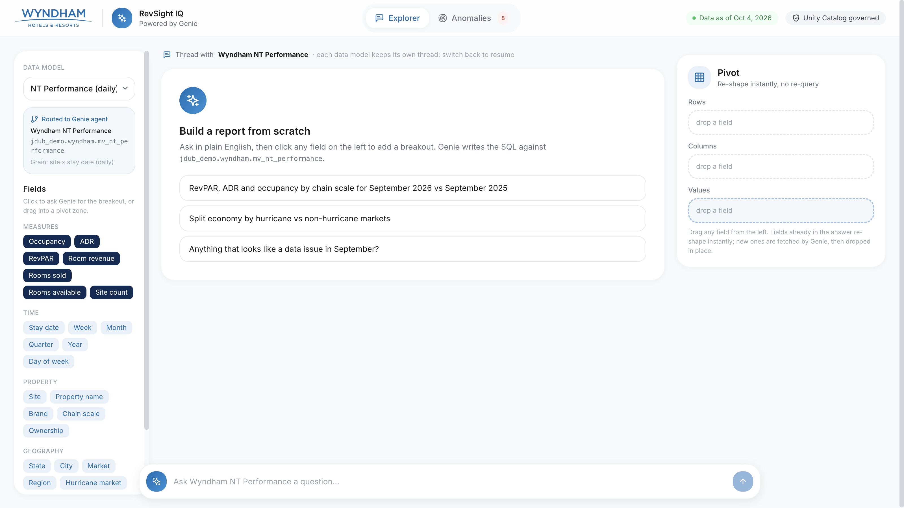
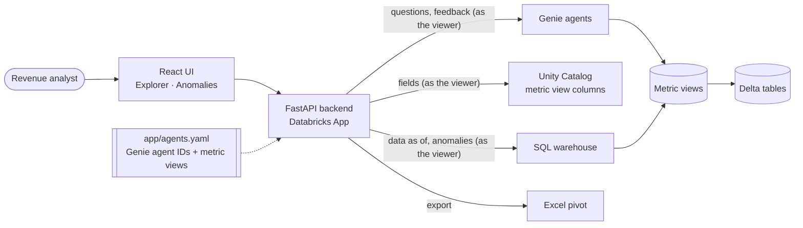

<p align="center">
  
</p>

<h1 align="center">RevSight IQ</h1>

<p align="center">
  <b>Ask hotel revenue questions in plain English. Get governed answers, pivots and Excel in seconds.</b><br>
  A Databricks App that puts Genie on top of Unity Catalog metric views for NT and STR performance data.
</p>

<p align="center">
  
  
  
  
  
</p>

<p align="center">
  
</p>

---


## ✨ What it does

| Tab | What you get |
|---|---|
| **Explorer** | Start from the Genie agent's own sample questions, or ask in plain English, then click any field to add a breakout. Genie writes the SQL against a governed metric view. The pivot panel re-shapes results without re-querying (drag fields in; ones the answer doesn't have yet are fetched by Genie), and one click exports a native Excel pivot. Tables come first; the chart view picks a chart type from the result's shape. Thumbs up/down and comments go to the Genie agent's feedback, recorded as the viewer. |
| **Anomalies** (demo only) | Outliers and data-quality issues (implausible revenue, capacity violations, missing NT feeds, RGI drops) with a chart against the expected band. Hidden when `app/agents.yaml` has no `anomalies` block. |

The demo ships two Genie agents: **NT Performance** (daily occupancy, ADR, RevPAR) and **STR Comp Set** (weekly RGI, MPI, ARI). Each knows the Wyndham glossary and refuses joins that don't make sense (for example booking channel by comp set). To point the app at **your own Genie agents and metric views**, see [Use your own Genie agent](#own-agent).

## 🏗️ How it works



**The app runs as each viewer** (Databricks Apps user authorization). Every Genie question, metric view lookup and query uses the signed-in user's own token and Unity Catalog access, limited to the scopes in `setup/user_api_scopes.json` (`genie`, `sql`, `catalog.tables:read`). The app has **no resources** and its service principal **needs no grants**; see [What the app's service principal does](#service-principal).

**What the app reads from each agent at runtime**, so `app/agents.yaml` only needs the agent ID and metric view:

| In the app | Comes from |
|---|---|
| Agent name in the picker and thread | The Genie agent's title |
| Home-screen starter questions | The agent's first 3 sample questions (its Common questions) |
| Field list (measures and dimensions, with descriptions) | The metric view's columns in Unity Catalog |
| "Data as of" | The latest value of the metric view's first date dimension (needs `warehouse_id`) |

## 🚀 Quick start: choose your path

| | Path | Best for | You need |
|---|---|---|---|
| ☁️ | **[Option A: In your Databricks workspace](#option-a)** (recommended) | Anyone; nothing to install. Demo **or** your own Genie agents | A browser and workspace access |
| 💻 | **[Option B: From your laptop](#option-b)** | Developers changing the code | Databricks CLI, Node 18+, Python 3.11+, `zsh` |
| 📦 | **[Option C: Declarative Automation Bundles](#option-c)** | Teams that deploy the demo with DABs or CI | Databricks CLI (bundles) |

**Before any path:** **read [Deploy to your own workspace](#deploy-your-own)**: the committed `config.env` and the `databricks.yml` defaults point at the reference demo, not at your schema.

<a id="option-a"></a>

### ☁️ Option A: In your Databricks workspace (recommended)

Everything runs inside Databricks with your own login. The notebook [`workspace_deploy`](workspace_deploy.py) has a **Deploy** widget: **demo** builds the synthetic data and two Genie agents, then the app; **app** deploys the app on the Genie agents in `app/agents.yaml` (see [Use your own Genie agent](#own-agent)). Every step is safe to re-run.

1. **Link GitHub (private repo).** You need access to this repo on GitHub and a GitHub credential in the workspace: **Settings > Linked accounts > Git integration**.
2. **Create a Git folder.** **Workspace > Create > Git folder**, paste `https://github.com/jonathan-whiteley/wyndham-revsight`, and create it (your home folder is fine).
3. **Let Genie Code drive.** Open the new folder, open **Genie Code** in **Agent mode**, and paste:

   ```text
   I want to deploy the RevSight IQ demo from this Git folder into my own schema.
   1. List the SQL warehouses I can use (prefer serverless) and the catalogs and schemas
      where I can create tables. Ask me to pick one of each, and ask for an app name
      (lowercase letters, numbers and dashes, unique in this workspace).
   2. Edit config.env in this folder: set APP_NAME, UC_CATALOG, UC_SCHEMA and WAREHOUSE_ID
      to my answers. Leave the Genie space IDs as they are; the notebook replaces them.
      If my warehouse is small, ask whether to set DATA_START=2025-09-01 for a faster build.
   3. Open the workspace_deploy notebook, set the Deploy widget to demo, attach it to
      serverless and run the cells in order. After each cell, tell me what it did. If a cell
      fails, stop, explain the error in plain words and tell me what to fix (the README
      Privileges table lists what each person needs).
   4. When the last cell finishes, give me the app URL and list who needs which access
      to use it (README Privileges table, "Each viewer" rows).
   ```

4. **Or do it by hand.** Edit `config.env` (`APP_NAME`, `UC_CATALOG`, `UC_SCHEMA`, `WAREHOUSE_ID`), open `workspace_deploy`, set **Deploy** to `demo`, attach **Serverless** and click **Run all**.
5. **Open the app.** Use the URL printed by the last cell and click **Authorize** on the consent screen on your first visit. Then share it: **Compute > Apps > your app > Permissions**, `CAN USE` for your viewers.

> [!NOTE]
> The notebook writes the new Genie space IDs back into `config.env` in your Git folder. That's expected; it's how re-runs update the same spaces instead of creating new ones, and how `app/agents.yaml` finds them. A re-run skips the data build when all tables already exist (set the **Demo data** widget to `rebuild` to force it).

<a id="option-b"></a>

### 💻 Option B: From your laptop

**Prerequisites:** [Databricks CLI](https://docs.databricks.com/aws/en/dev-tools/cli/install) authenticated to your workspace (`databricks auth login --profile <name>`), Node 18+, Python 3.11+, `zsh`.

```bash
git clone git@github.com:jonathan-whiteley/wyndham-revsight.git && cd wyndham-revsight
(cd app/frontend && npm install)
```

1. **Edit `config.env`** (see the next section).
2. **Build the demo data** in your schema: tables, metric views and planted anomalies. Skip for your own agents.
   ```bash
   scripts/setup_data.sh            # resume after a failure with: --from 09
   ```
3. **Create the two Genie agents**, then paste the two IDs it prints into `config.env`. Skip for your own agents (edit `app/agents.yaml` instead).
   ```bash
   scripts/create_genie_spaces.sh
   ```
4. **Create the app** with user authorization scopes and no resources.
   ```bash
   scripts/create_app.sh
   ```
5. **Deploy** and open the URL it prints.
   ```bash
   scripts/deploy.sh
   ```

Already have the data and Genie spaces (for example in the reference demo workspace)? Skip to step 4.

<a id="option-c"></a>

### 📦 Option C: Declarative Automation Bundles (DABs)

The repo is also a bundle **for the demo**. The root `databricks.yml` declares the app (with its user authorization scopes and no resources) and both Genie spaces; a small second bundle in `setup/` builds the demo data. **This path reads `databricks.yml` and `--var` flags, not `config.env`.**

**Set your values once:** uncomment the `mine` target in both `databricks.yml` files, fill in `host` and the variables (`catalog`, `schema`, `warehouse_id`, and `app_name` in the root one), then:

```bash
# 1. Demo data, once per schema (Genie can't create a space until its tables exist)
(cd setup && databricks bundle deploy -t mine && databricks bundle run build_data -t mine)

# 2. App + Genie spaces
databricks bundle validate --strict -t mine
databricks bundle deploy -t mine
databricks bundle run revsight -t mine    # deploys the app code; prints the URL
```

- **Variables:** `catalog`, `schema`, `warehouse_id` (both bundles), `app_name` (root), `data_start` and `data_mode` (`auto`, `rebuild` or `skip`; `setup/` only). Every variable has a reference-demo default, so always set your own. You can also pass them as flags, for example `--var catalog=my_catalog --var schema=my_schema`.
- **One definition everywhere:** `resources/revsight.genie_spaces.yml` is generated from `setup/genie/build_agents.py` (run `python3 setup/genie/build_agents.py --bundle` after you edit it), and the data job calls the same `setup/deploy_lib.py` as the `workspace_deploy` notebook.
- **App name:** `mode: development` prefixes the jobs and Genie titles with `[dev <you>]` but **not** the app name, so pick a unique `app_name`.
- **Scopes:** `resources/revsight.app.yml` lists them; keep it in sync with `setup/user_api_scopes.json`.
- **From the workspace UI:** a Git folder that contains `databricks.yml` can also be deployed from the workspace's bundle UI. That route wasn't tested for this repo; the CLI commands above were.

> [!WARNING]
> **Adopting an app that already exists** (for example one you deployed with Option A or B): link it first with `databricks bundle deployment bind revsight <existing-app-name> -t mine`, then run `databricks bundle plan -t mine` and check the app shows as `update`, **not** delete and create, before you deploy. A different `app_name` than the one in the bundle's state force-recreates the app: new service principal, new URL, and every viewer approves it again.

<a id="own-agent"></a>

## 🔌 Use your own Genie agent

Point the app at any Genie agents (for example a customer's) by editing **one file, `app/agents.yaml`**, then deploying with **Deploy = app**. No demo data, no new Genie agents, no grants for the app.

**You need:** the **Genie agent ID** for each agent (in the agent's URL, or its **About** tab) and, ideally, the **metric view** it's built on (that's where the field list and "data as of" come from). A warehouse is optional; it only powers "data as of".

```yaml
# app/agents.yaml for your own agents: literal values, no demo blocks
warehouse_id: 0123456789abcdef      # optional: remove to hide "data as of"

agents:
  - key: perf                       # short id, used in URLs (?model=perf)
    space_id: 01f0abc...            # Genie agent ID
    metric_view: main.revenue.property_performance
    label: Property performance     # optional (default: the agent's title)
  # - key: second_agent
  #   space_id: ...
  #   metric_view: ...
```

Optional per agent: `grain` (shown under the agent name), `starter_measure` / `starter_dimension` (first question when a field is clicked on an empty thread; `{label}` is the field), `field_groups` and `labels` (group, order and rename the metric view's fields; see the demo entries), `date_field` (the dimension behind "data as of"). Delete the `anomalies` block: it only works with the demo tables. With one agent the data model picker hides itself.

**Let Genie Code drive.** In your Git folder of this repo, open **Genie Code** in **Agent mode** and paste:

```text
I want to deploy the RevSight IQ app from this Git folder on my own Genie agents.
1. List the Genie agents I can open (GET /api/2.0/genie/spaces) and ask me which ones to use.
   For each one, find the metric view it's built on (from the agent's tables if I can edit
   it, otherwise ask me) and check it exists.
2. Rewrite app/agents.yaml with literal values (no ${...}): one entry per agent with key
   (short, lowercase), space_id, metric_view and label. Remove the anomalies block and the
   demo-only lines (field_groups, labels, starter_measure, starter_dimension). Ask whether I
   want the "data as of" date: if yes, list the SQL warehouses I can use, ask me to pick one
   and set warehouse_id to its ID; if no, remove warehouse_id.
3. In config.env, set APP_NAME to a name I choose (lowercase letters, numbers and dashes,
   unique in this workspace). Leave the other settings alone.
4. Open the workspace_deploy notebook, set the Deploy widget to app, attach it to serverless
   and run the cells in order. After each cell, tell me what it did. If a cell fails, stop
   and explain in plain words what to fix.
5. When it finishes, give me the app URL and list who needs which access to use it
   (README Privileges table, "Each viewer" rows).
```

**Or by hand:** edit `app/agents.yaml` as above, set `APP_NAME` in `config.env`, open `workspace_deploy`, set **Deploy** to `app`, attach **Serverless** and click **Run all**. The preflight checks that each agent opens for you and each metric view exists before anything is created. From a laptop: `scripts/create_app.sh`, then `scripts/deploy.sh`.

> [!TIP]
> **Check before you share.** Each viewer needs their own access to the agent and its data (see [Privileges](#privileges)). Open the app as a non-admin colleague once: if their field list is empty or Genie says it can't open the agent, it's their Unity Catalog or Genie permissions, not the app.

<a id="deploy-your-own"></a>

## 🔧 Deploy to your own workspace, catalog and schema

> [!IMPORTANT]
> **Change `config.env` before you run anything.** The committed values point at the reference demo workspace (`jdub_demo.wyndham`). You almost certainly can't write there, and its Genie spaces aren't shared with you. Most users can only write to one or two schemas, so point `UC_CATALOG` and `UC_SCHEMA` at a schema you already own. The scripts never create catalogs or schemas.

### What to change

| Setting | File | What to set | Default (reference demo) |
|---|---|---|---|
| `DATABRICKS_PROFILE` | `config.env` | Your CLI profile from `~/.databrickscfg` (laptop path only) | `DEFAULT` |
| `APP_NAME` | `config.env` | A unique app name in your workspace | `wyndham-revsight` |
| `UC_CATALOG` | `config.env` | Demo: a catalog you have `USE CATALOG` on | `jdub_demo` |
| `UC_SCHEMA` | `config.env` | Demo: an existing schema you can create tables in | `wyndham` |
| `WAREHOUSE_ID` | `config.env` | Demo: a SQL warehouse you can use (serverless recommended); feeds `warehouse_id` in `app/agents.yaml` | `c02d7ad10080ab8d` |
| `GENIE_SPACE_NT` / `GENIE_SPACE_STR` | `config.env` | Demo: written for you by `workspace_deploy`; from a laptop, the IDs printed by `scripts/create_genie_spaces.sh` | the demo's two spaces |
| `DATA_START` | `config.env` (optional) | Demo: first day of history; later is faster (keep it on or before `2025-09-01` for the year-over-year questions) | `2019-01-01` (556M reservations) |
| `WORKSPACE_APP_PATH` | `config.env` (optional) | Where the app source is uploaded | `/Workspace/Users/<you>/apps/<APP_NAME>` |
| `GENIE_PARENT_PATH` | `config.env` (optional) | Demo: workspace folder for the Genie spaces | `/Workspace/Users/<you>/genie_spaces` |
| Genie agents | `app/agents.yaml` | Which agents and metric views the app uses ([Use your own Genie agent](#own-agent)) | the two demo agents, via the `${VAR}`s above |

Everything else follows from these values: the SQL in `setup/sql/` uses `{{catalog}}`, `{{schema}}` and `{{data_start}}` placeholders, the Genie definitions are generated from `config.env`, and `scripts/deploy.sh` and the notebook copy `config.env` into the deployed `app.yaml`, which fills the `${VAR}`s in `app/agents.yaml`.

**Optional customizations (not required to deploy):**
- **Genie instructions, sample questions and example SQL:** `setup/genie/build_agents.py`. Push edits with `scripts/create_genie_spaces.sh --update`. The first three sample questions become the app's starters.
- **Data volume:** set `DATA_START` in `config.env`. The full history (`2019-01-01`) builds 556M reservations; `2025-09-01` builds about 15% of that and keeps the year-over-year demo questions working.
- **Branding:** `app/frontend/public/wyndham-logo.svg` and `app/frontend/tailwind.config.js`.

<a id="privileges"></a>

### Privileges

| Who | Needs | Why |
|---|---|---|
| **You** (the person deploying) | Access to Databricks Apps in the workspace | Create the app |
| | Demo only: `USE CATALOG` on `UC_CATALOG`, `USE SCHEMA` and `CREATE TABLE` on the schema, `CAN USE` on the warehouse, access to Genie | Build the tables and metric views, create the two agents |
| | Your own agents: at least `CAN VIEW` on each agent and visibility of its metric view | The notebook preflight opens them as you |
| **Each viewer** (or a group) | `CAN USE` on the app | Open it |
| | At least `CAN VIEW` (or `CAN RUN`) on each Genie agent | Ask questions and send feedback |
| | `USE CATALOG`, `USE SCHEMA` and `SELECT` on the agent's metric views (and anything else the agent reads) | Genie and the field list check the viewer's own Unity Catalog access |
| | `CAN USE` on the app's `warehouse_id`, only if it's set | "Data as of" and Anomalies run SQL as the viewer. Genie itself doesn't need it: it runs on its agent's warehouse with the author's compute credentials |
| | Demo Anomalies only: `SELECT` on `anomaly_site_day`, `dim_site`, `fact_sales_occupancy` | The Anomalies tab reads them directly |
| **The app's service principal** | **Nothing** | See below |

Each viewer clicks **Authorize** on a consent screen (Genie, Databricks SQL, read Unity Catalog tables) the first time they open the app, and again whenever its scopes change.

<a id="service-principal"></a>

### 🔐 What the app's service principal does

Every Databricks App gets a service principal; this one is never used for data.

- **No resources:** `scripts/create_app.sh`, the notebook and the bundle create the app with **no** warehouse or Genie resources, so the platform grants the service principal nothing. Re-running them on an app from an older version detaches its resources (which also removes those permissions).
- **No grants:** there's no grant step. Nothing in the app calls Databricks with the service principal's credentials.
- **No fallback:** in Databricks Apps, an API request without the viewer's token gets `401` instead of quietly running as the service principal.
- **Upgrading an older deployment?** Older versions also granted the service principal access to the demo schema. Revoke it; the app doesn't need it:
  ```sql
  REVOKE SELECT, USE SCHEMA ON SCHEMA my_catalog.my_schema FROM `<service principal client id>`;
  REVOKE USE CATALOG ON CATALOG my_catalog FROM `<service principal client id>`;
  ```

## 🧪 Local development

```bash
python3 -m venv .venv && source .venv/bin/activate
pip install -r app/requirements.txt
scripts/run_local.sh          # built UI + API on http://localhost:8000
scripts/run_local.sh --dev    # Vite hot reload on http://localhost:5173
```

The built UI in `app/frontend/dist` is **committed** so the workspace path needs no Node. After you change `app/frontend/src`, run `(cd app/frontend && npm run build)` and commit `dist` too (`scripts/deploy.sh` rebuilds it automatically).

Locally the app runs as **you** (your CLI profile), so it sees whatever you can see. In Databricks Apps it runs as each viewer; open it as a non-admin colleague before you share the link widely.

To re-run the demo questions against your Genie spaces and record answers and timings:
```bash
set -a; source config.env; set +a; python3 setup/genie/acceptance.py
```

## 📁 Project structure

```
.
├── config.env                 ← where and how to deploy (scripts and the notebook read it)
├── workspace_deploy.py        ← Option A: deploy from a Databricks notebook (Deploy = demo or app)
├── databricks.yml             ← Option C: bundle (app + demo Genie spaces)
├── resources/                 bundle resources (Genie spaces generated from setup/genie)
├── app/                       ← exactly what ships to Databricks Apps
│   ├── agents.yaml            ← which Genie agents and metric views the app uses
│   ├── app.yaml               template: "{{KEY}}"s filled from config.env by deploy.sh and the notebook (the bundle uses resources/revsight.app.yml)
│   ├── main.py                FastAPI entry point (forwards the viewer's token; 401 without one)
│   ├── api/                   HTTP routes
│   ├── services/              Genie, agent metadata, SQL, anomalies, Excel export, user auth
│   ├── config/settings.py     reads agents.yaml
│   └── frontend/              React + Vite UI (dist/ is committed and is all that's deployed)
├── setup/
│   ├── databricks.yml         Option C: the small data bundle (run once per schema)
│   ├── deploy_lib.py          shared steps for the notebook, scripts and the bundle job
│   ├── user_api_scopes.json   the app's user authorization scopes
│   ├── jobs/                  bundle job notebook: build_data
│   ├── sql/                   01-14 data build, run in order
│   └── genie/                 Genie agent definitions (build_agents.py) + acceptance test
├── scripts/                   setup_data, create_genie_spaces, create_app, deploy, run_local
└── docs/
    ├── images/                README screenshot
    └── design/                Genie acceptance test results
```

## 🩺 Troubleshooting

| Symptom | Fix |
|---|---|
| `401` and "No user token" from every API call | The app has no `user_api_scopes`, or the workspace allowlist removed them. Re-run `scripts/create_app.sh` or the notebook's step 5, and have a workspace admin check **Settings > Development > Apps**. |
| Setting the scopes fails, or deploy fails with `user token passthrough not enabled` | The workspace's app scope allowlist doesn't include them (or is set to `None`). A workspace admin adds `genie`, `sql` and `catalog.tables:read` under **Settings > Development > Apps**. |
| `does not have required scopes: genie` (or `unity-catalog`), or a `403` on `OpenSession` | The viewer approved the app before its scopes changed, so their token is stale. Have them open the app in a fresh browser session (or sign out of the app) and click **Authorize** again. Use `genie`, not the deprecated `dashboards.genie`. |
| Sign-in loops back with `access_denied` and `Scopes 'sql:read:restricted-query' are not assigned` | `sql:read` and `sql:restricted-query` can't be combined. Keep the scopes in `setup/user_api_scopes.json`. |
| Agent picker shows "You can't open this Genie agent yet" | The viewer needs at least `CAN VIEW` on the agent. No redeploy needed. |
| Field list is empty | The viewer can't see the metric view (`USE CATALOG`, `USE SCHEMA`, `SELECT`), or `metric_view` in `app/agents.yaml` is wrong. `databricks apps logs <APP_NAME>` shows the error. |
| No starter questions on the home screen | The agent has no sample questions. Add some under the agent's **Common questions** (demo: `setup/genie/build_agents.py`). |
| "Data as of" is missing | `warehouse_id` isn't set, or the metric view has no date dimension (set `date_field` for the agent). |
| The SQL time chip says "SQL time n/a" for some viewers | Query history shows a run only to its owner or to people with `CAN VIEW` on its warehouse. Give those viewers `CAN VIEW` on the Genie agent's warehouse. |
| Notebook preflight stops at "Fix agents.yaml" | It lists each agent or metric view that didn't open for you. Fix the ID or name, or get access, and re-run. |
| `apps create-update` fails right after creating the app | The app's compute is still starting. Wait until `databricks apps get <APP_NAME>` shows compute `ACTIVE`. |
| Deploy hangs for 10+ minutes, then fails | `package.json` or `node_modules` reached the workspace and triggered a Node build. Only deploy with `scripts/deploy.sh` or the notebook, which upload runtime files and the built UI only. |
| UI doesn't change after a deploy | Compare the `uploaded:` and `local:` bundle hashes `deploy.sh` prints; they must match. |
| `AttributeError` on Genie SDK objects in the app only | Keep the exact pins in `app/requirements.txt`; the Apps base image ships an older `databricks-sdk`. |
| Notebook stops at preflight: `can't create tables` | Demo only: you need `USE CATALOG`, `USE SCHEMA` and `CREATE TABLE`; pick another schema or ask its owner (see Privileges). |
| Metric view YAML parse error when running setup SQL by hand | Some CLI query tools strip indentation. Use `scripts/setup_data.sh` (Statement Execution API). |

## 📝 About the data

All demo data is **synthetic**: about 9,000 sites, NT daily performance from 2019 to 2026-10-04, STR weekly comp sets and 556M reservations, generated with set-based SQL. A few stories are planted for demos (a Gulf hurricane dip in Aug-Sep 2026, a $2.1M fat-finger night at S04217, a Tampa NT feed gap and a group crew pickup at S05512). None of it is Wyndham's real data. With your own agents, the app reads only what each viewer can already see.

---

<p align="center">Made with ❤️ by Jonathan Whiteley at Databricks</p>
