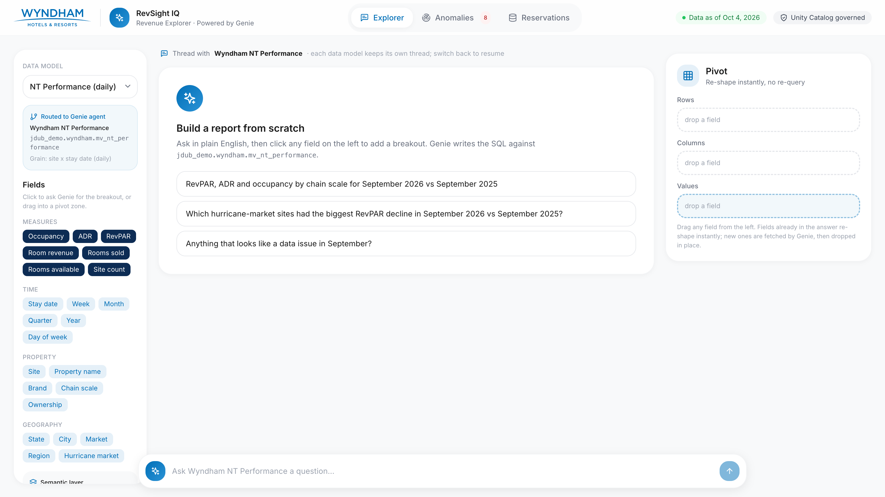
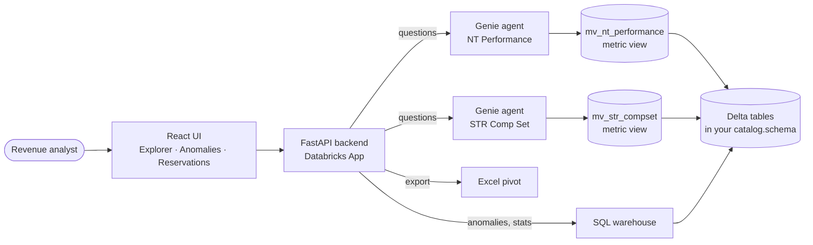

<p align="center">
  
</p>

<h1 align="center">RevSight IQ</h1>

<p align="center">
  <b>Ask hotel revenue questions in plain English. Get governed answers, pivots and Excel in seconds.</b><br>
  A Databricks App that puts Genie on top of Unity Catalog metric views for NT and STR performance data.
</p>

<p align="center">
  
  
  
  
  
</p>

<p align="center">
  
</p>

---

## ✨ What it does

| Tab | What you get |
|---|---|
| **Explorer** | Ask a question, then click any field to add a breakout. Genie writes the SQL against a governed metric view; the pivot panel re-shapes results without re-querying; one click exports a native Excel pivot. |
| **Anomalies** | Outliers and data-quality issues (implausible revenue, capacity violations, missing NT feeds, RGI drops) with a chart against the expected band. |
| **Reservations** | Drill to confirmation-level rows on a 556M-row reservation table, with live query performance stats. |

Two Genie agents sit behind the app: **NT Performance** (daily occupancy, ADR, RevPAR) and **STR Comp Set** (weekly RGI, MPI, ARI). Each knows the Wyndham glossary and refuses joins that don't make sense (for example booking channel by comp set).

## 🏗️ How it works



Everything the app reads lives in **one Unity Catalog schema** that you choose. The app's service principal only needs read access to it.

## 🚀 Quick start: choose your path

| | Path | Best for | You need |
|---|---|---|---|
| ☁️ | **[Option A: In your Databricks workspace](#option-a)** (recommended) | Anyone; nothing to install | A browser and workspace access |
| 💻 | **[Option B: From your laptop](#option-b)** | Developers changing the code | Databricks CLI, Node 18+, Python 3.11+, `zsh` |
| 📦 | **[Option C: Declarative Automation Bundles](#option-c)** | Teams that deploy with DABs or CI | Databricks CLI (bundles) |

Either way, **read [Deploy to your own workspace, catalog and schema](#deploy-your-own) first**: the committed `config.env` (Options A and B) and the `databricks.yml` defaults (Option C) point at the reference demo, not at your schema.

<a id="option-a"></a>

### ☁️ Option A: In your Databricks workspace (recommended)

Everything runs inside Databricks with your own login. The notebook [`workspace_deploy`](workspace_deploy.py) does what the laptop scripts do: preflight checks, demo data, Genie agents, the app, access grants and the deploy. Every step is safe to re-run.

1. **Link GitHub (private repo).** You need access to this repo on GitHub and a GitHub credential in the workspace: **Settings > Linked accounts > Git integration**.
2. **Create a Git folder.** **Workspace > Create > Git folder**, paste `https://github.com/jonathan-whiteley/wyndham-revsight`, and create it (your home folder is fine).
3. **Let Genie Code drive.** Open the new folder, open **Genie Code** in **Agent mode**, and paste:

   ```text
   I want to deploy the RevSight IQ app from this Git folder into my own schema.
   1. List the SQL warehouses I can use (prefer serverless) and the catalogs and schemas
      where I can create tables. Ask me to pick one of each, and ask for an app name
      (lowercase letters, numbers and dashes, unique in this workspace).
   2. Edit config.env in this folder: set APP_NAME, UC_CATALOG, UC_SCHEMA and WAREHOUSE_ID
      to my answers. Leave the Genie space IDs as they are; the notebook replaces them.
      If my warehouse is small, ask whether to set DATA_START=2025-09-01 for a faster build.
   3. Open the workspace_deploy notebook, attach it to serverless and run the cells in
      order. After each cell, tell me what it did. If a cell fails, stop, explain the error
      in plain words and tell me what to fix (missing privileges are listed in the README
      Privileges table).
   4. When the last cell finishes, give me the app URL and any GRANT statements I need to
      send to my schema owner.
   ```

4. **Or do it by hand.** Edit `config.env` (`APP_NAME`, `UC_CATALOG`, `UC_SCHEMA`, `WAREHOUSE_ID`), open `workspace_deploy`, attach **Serverless** and click **Run all**.
5. **Open the app.** Use the URL printed by the last cell and approve the consent prompt on your first visit.

> [!NOTE]
> The notebook writes the new Genie space IDs back into `config.env` in your Git folder. That's expected; it's how re-runs update the same spaces instead of creating new ones. A re-run skips the data build when all tables already exist (set the **Demo data** widget to `rebuild` to force it).

<a id="option-b"></a>

### 💻 Option B: From your laptop

**Prerequisites:** [Databricks CLI](https://docs.databricks.com/dev-tools/cli/install.html) authenticated to your workspace (`databricks auth login --profile <name>`), Node 18+, Python 3.11+, `zsh`.

```bash
git clone git@github.com:jonathan-whiteley/wyndham-revsight.git && cd wyndham-revsight
(cd app/frontend && npm install)
```

1. **Edit `config.env`** (the only file you need to touch, see the next section).
2. **Build the demo data** in your schema: tables, metric views and planted anomalies.
   ```bash
   scripts/setup_data.sh            # resume after a failure with: --from 09
   ```
3. **Create the two Genie agents**, then paste the two IDs it prints into `config.env`.
   ```bash
   scripts/create_genie_spaces.sh
   ```
4. **Create the app and bind its resources** (warehouse + both Genie spaces).
   ```bash
   scripts/bind_resources.sh
   ```
5. **Give the app read access** to your schema and Genie spaces.
   ```bash
   scripts/grant_app_access.sh
   ```
6. **Deploy** and open the URL it prints.
   ```bash
   scripts/deploy.sh
   ```

Already have the data and Genie spaces (for example in the reference demo workspace)? Skip to step 6.

<a id="option-c"></a>

### 📦 Option C: Declarative Automation Bundles (DABs)

The repo is also a bundle. The root `databricks.yml` declares the app, both Genie spaces (with `CAN_RUN` for the app's service principal) and a grant job; a small second bundle in `setup/` builds the demo data. **This path reads `databricks.yml` and `--var` flags, not `config.env`.**

```bash
V="--var catalog=my_catalog --var schema=my_schema --var warehouse_id=0123456789abcdef"

# 1. Demo data, once per schema (Genie can't create a space until its tables exist)
cd setup
databricks bundle deploy $V
databricks bundle run build_data $V           # add --var data_start=2025-09-01 to both for a faster build
cd ..

# 2. App + Genie spaces + grants
A="$V --var app_name=my-revsight"            # unique in the workspace, 30 characters max
databricks bundle validate --strict $A
databricks bundle deploy $A
databricks bundle run grant_app_access $A     # schema grants for the app's service principal
databricks bundle run revsight $A             # deploys the app code with your catalog/schema; prints the URL
```

- **Variables:** `catalog`, `schema`, `warehouse_id` (both bundles), `app_name` (root), `data_start` and `data_mode` (`auto`, `rebuild` or `skip`; `setup/` only). Every variable has a reference-demo default, so always pass your own.
- **Your own workspace:** uncomment the `mine` target in both `databricks.yml` files, fill in `host` and the variables, and add `-t mine` to every command.
- **One definition everywhere:** `resources/revsight.genie_spaces.yml` is generated from `setup/genie/build_agents.py` (run `python3 setup/genie/build_agents.py --bundle` after you edit it), and both bundle jobs call the same `setup/deploy_lib.py` as the `workspace_deploy` notebook.
- **Why a grant job:** a bundle can only grant on schemas it creates. If you can't GRANT on yours, the job prints the statements for your schema owner.
- **App name:** `mode: development` prefixes the jobs and Genie titles with `[dev <you>]` but **not** the app name, so pick a unique `app_name`.
- **From the workspace UI:** a Git folder that contains `databricks.yml` can also be deployed from the workspace's bundle UI (open the folder and use its deploy option). That route wasn't tested for this repo; the CLI commands above were.

> [!WARNING]
> **Adopting an app that already exists** (for example one you deployed with Option A or B): link it first with `databricks bundle deployment bind revsight <existing-app-name> $A`, then run `databricks bundle plan $A` and check the app shows as `update`, **not** delete and create, before you deploy. A different `app_name` than the one in the bundle's state force-recreates the app: new service principal, new grants, new URL. Always pass the same `--var` flags you deployed with.

<a id="deploy-your-own"></a>

## 🔧 Deploy to your own workspace, catalog and schema

> [!IMPORTANT]
> **Change `config.env` before you run anything.** The committed values point at the reference demo workspace (`jdub_demo.wyndham`). You almost certainly can't write there, and its Genie spaces aren't shared with you. Most users can only write to one or two schemas, so point `UC_CATALOG` and `UC_SCHEMA` at a schema you already own. The scripts never create catalogs or schemas.

### What to change

| Setting | File | What to set | Default (reference demo) |
|---|---|---|---|
| `DATABRICKS_PROFILE` | `config.env` | Your CLI profile from `~/.databrickscfg` (laptop path only) | `DEFAULT` |
| `APP_NAME` | `config.env` | A unique app name in your workspace | `wyndham-revsight` |
| `UC_CATALOG` | `config.env` | A catalog you have `USE CATALOG` on | `jdub_demo` |
| `UC_SCHEMA` | `config.env` | An existing schema you can create tables in | `wyndham` |
| `WAREHOUSE_ID` | `config.env` | A SQL warehouse you can use (serverless recommended) | `c02d7ad10080ab8d` |
| `GENIE_SPACE_NT` / `GENIE_SPACE_STR` | `config.env` | Written for you by `workspace_deploy`; from a laptop, the IDs printed by `scripts/create_genie_spaces.sh` | the demo's two spaces |
| `DATA_START` | `config.env` (optional) | First day of demo history; later is faster (keep it on or before `2025-09-01` for the year-over-year questions) | `2019-01-01` (556M reservations) |
| `WORKSPACE_APP_PATH` | `config.env` (optional) | Where the app source is uploaded | `/Workspace/Users/<you>/apps/<APP_NAME>` |
| `GENIE_PARENT_PATH` | `config.env` (optional) | Workspace folder for the Genie spaces | `/Workspace/Users/<you>/genie_spaces` |

Everything else follows from these values: the SQL in `setup/sql/` uses `{{catalog}}`, `{{schema}}` and `{{data_start}}` placeholders, the Genie definitions are generated from `config.env`, and `scripts/deploy.sh` writes your catalog and schema into the deployed `app.yaml`.

**Optional customizations (not required to deploy):**
- **Genie instructions, sample questions and example SQL:** `setup/genie/build_agents.py`. Push edits with `scripts/create_genie_spaces.sh --update`.
- **Data volume:** set `DATA_START` in `config.env`. The full history (`2019-01-01`) builds 556M reservations; `2025-09-01` builds about 15% of that and keeps the year-over-year demo questions working.
- **Branding:** `app/frontend/public/wyndham-logo.svg` and `app/frontend/tailwind.config.js`.

### Privileges

| Who | Needs | Why |
|---|---|---|
| **You** (the person running the notebook or scripts) | `USE CATALOG` on `UC_CATALOG` | Reach the schema |
| | `USE SCHEMA` and `CREATE TABLE` on `UC_CATALOG.UC_SCHEMA` | Create the tables and metric views |
| | `CAN_USE` on the SQL warehouse | Run the setup SQL |
| | Access to Databricks Apps and Genie in the workspace | Create the app and the two spaces |
| **The app's service principal** (created with the app) | `USE CATALOG`, `USE SCHEMA`, `SELECT` on the schema | Read the data (`scripts/grant_app_access.sh`) |
| | `CAN_RUN` on both Genie spaces | Genie spaces aren't covered by app resources (`scripts/grant_app_access.sh`) |
| | `CAN_USE` on the warehouse | Granted automatically by `bind_resources.sh` + `deploy.sh` |

> [!TIP]
> **Can't run `GRANT` on your schema?** That's common when you have write access but don't own the schema. Send `scripts/grant_app_access.sh` and your `config.env` to the schema owner (or anyone with `MANAGE` on it) and ask them to run it. It prints exactly what it grants.

## 🧪 Local development

```bash
python3 -m venv .venv && source .venv/bin/activate
pip install -r app/requirements.txt
scripts/run_local.sh          # built UI + API on http://localhost:8000
scripts/run_local.sh --dev    # Vite hot reload on http://localhost:5173
```

The built UI in `app/frontend/dist` is **committed** so the workspace path needs no Node. After you change `app/frontend/src`, run `(cd app/frontend && npm run build)` and commit `dist` too (`scripts/deploy.sh` rebuilds it automatically).

Locally the app runs as **you** (your CLI profile), so it sees whatever you can see. In Databricks Apps it runs as its service principal; test there before you share the link.

To re-run the demo questions against your Genie spaces and record answers and timings:
```bash
set -a; source config.env; set +a; python3 setup/genie/acceptance.py
```

## 📁 Project structure

```
.
├── config.env                 ← the one file to edit
├── workspace_deploy.py        ← Option A: deploy from a Databricks notebook
├── databricks.yml             ← Option C: bundle (app, Genie spaces, grant job)
├── resources/                 bundle resources (Genie spaces generated from setup/genie)
├── app/                       ← exactly what ships to Databricks Apps
│   ├── app.yaml               template: catalog/schema filled in by deploy.sh and the notebook (the bundle uses resources/revsight.app.yml)
│   ├── main.py                FastAPI entry point
│   ├── api/                   HTTP routes
│   ├── services/              Genie, SQL, anomalies, Excel export
│   ├── config/settings.py     reads env (catalog, schema, warehouse, Genie IDs)
│   └── frontend/              React + Vite UI (dist/ is committed and is all that's deployed)
├── setup/
│   ├── databricks.yml         Option C: the small data bundle (run once per schema)
│   ├── deploy_lib.py          shared steps for the notebook and the bundle jobs
│   ├── jobs/                  bundle job notebooks: build_data, grant_app_access
│   ├── sql/                   01-14 data build, run in order
│   └── genie/                 Genie agent definitions (build_agents.py) + acceptance test
├── scripts/                   setup_data, create_genie_spaces, bind_resources,
│                              grant_app_access, deploy, run_local
└── docs/
    ├── images/                README screenshot
    └── design/                Genie acceptance test results
```

## 🩺 Troubleshooting

| Symptom | Fix |
|---|---|
| Genie calls fail with `PermissionDenied: Unable to get space` | The app's service principal isn't on the space ACL. Run `scripts/grant_app_access.sh` (no redeploy needed). |
| Data calls fail with `Error during request to server` or `TABLE_OR_VIEW_NOT_FOUND` | Check `UC_CATALOG`/`UC_SCHEMA`, run `scripts/grant_app_access.sh`, then `scripts/deploy.sh` (a deploy is what grants warehouse access after resources change). |
| Resources disappeared from the app | `databricks apps update` replaces the whole object. Always use `scripts/bind_resources.sh`, which sends the full list. |
| `apps update` fails right after creating the app | The app's compute is still starting. Wait until `databricks apps get <APP_NAME>` shows compute `ACTIVE`. |
| Deploy hangs for 10+ minutes, then fails | `package.json` or `node_modules` reached the workspace and triggered a Node build. Only deploy with `scripts/deploy.sh`, which uploads runtime files and the built UI only. |
| UI doesn't change after a deploy | Compare the `uploaded:` and `local:` bundle hashes `deploy.sh` prints; they must match. |
| Every page returns 502 while the app shows RUNNING | Usually a SQL connector auth problem. Keep `credentials_provider` in `app/services/sql_service.py` and check `databricks apps logs <APP_NAME>`. |
| `AttributeError` on Genie SDK objects in the app only | Keep the exact pins in `app/requirements.txt`; the Apps base image ships an older `databricks-sdk`. |
| Notebook stops at preflight: `can't create tables` | You need `USE CATALOG`, `USE SCHEMA` and `CREATE TABLE`; pick another schema or ask its owner (see Privileges). |
| Notebook prints GRANT statements and says to send them to your schema owner | The app deployed but can't read the data yet. Once the owner runs them, refresh the app; no redeploy needed. |
| Metric view YAML parse error when running setup SQL by hand | Some CLI query tools strip indentation. Use `scripts/setup_data.sh` (Statement Execution API). |

## 📝 About the data

All data is **synthetic**: about 9,000 sites, NT daily performance from 2019 to 2026-10-04, STR weekly comp sets and 556M reservations, generated with set-based SQL. A few stories are planted for demos (a Gulf hurricane dip in Aug-Sep 2026, a $2.1M fat-finger night at S04217, a Tampa NT feed gap and a group crew pickup at S05512). None of it is Wyndham's real data.

---

<p align="center">Made with ❤️ by Jonathan Whiteley at Databricks</p>
